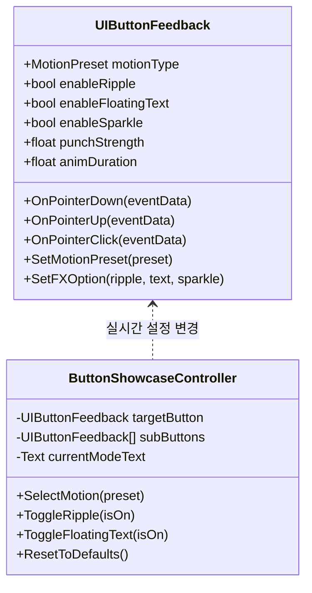

# [작업지시서] 모듈형 버튼 인터랙션 시스템 & ButtonScene 쇼케이스 구축

## 1. 개요 및 목적 (Overview)
- **작업 목적**:
  1. **초경량 모듈형 버튼 피드백 컴포넌트(`UIButtonFeedback.cs`) 개발**:
     - 기존 Unity `Button`이 부착된 어떤 오브젝트에든 스크립트만 붙이면 즉시 고품질 DOTween 손맛(모션 + FX)이 발동되는 컴포넌트 기반 아키텍처 구축.
     - 다른 씬이나 타 프로젝트로의 이식성(Portability) 및 재사용성 극대화.
  2. **물류 타이쿤 테마에 최적화된 5대 모션 프리셋 구현**:
     - ① 젤리 스쿼시 (Jelly Squash & Elastic Bounce)
     - ② 3D 뎁스 스위치 (Depth Press & Shadow Shift)
     - ③ 스탬프 쾅 임팩트 (Stamp Hit & Punch)
     - ④ 네온 펄스 (Neon Glow Pulse)
     - ⑤ 세련된 심플 팝 (Gentle Scale Pop)
  3. **동적 추가 FX 시스템 (Add-on FX Prefabs)**:
     - 터치/클릭 좌표 기반 원형 물결 리플 (`RippleEffect.prefab`)
     - 상향 부유하는 코인/EXP 플로팅 텍스트 (`FloatingText.prefab`)
     - 클릭 시 튀는 별빛 스파클 파티클 (`SparkleBurst.prefab`)
  4. **`ButtonScene.unity` 인터랙티브 쇼케이스 구성**:
     - 중앙 대형 테스트 버튼 및 형태별 서브 버튼(사각, 원형, 아이콘).
     - 우측/하단 모드 스위처 패널을 통해 실시간으로 모션을 교체하고 콤보 FX를 켜고 끄며 손맛을 비교·체험할 수 있는 데모 환경 구축.

---

## 2. 시스템 아키텍처 및 컴포넌트 설계

### 2.1 컴포넌트 구조도


### 2.2 모션 프리셋 상세 규격 (5 Presets)
1. **`JellySquash` (젤리 바운스)**:
   - `PointerDown`: 가로로 늘어나고 세로로 납작 (`Vector3(1.15f, 0.82f, 1f)`, duration 0.1s, `OutQuad`).
   - `PointerUp`: 탄성 있게 띠용~ 원복 (`Vector3(1f, 1f, 1f)`, duration 0.45s, `OutElastic`).
2. **`DepthPress` (3D 플라스틱 스위치)**:
   - `PointerDown`: 버튼 본체(Target Graphic)가 Y축으로 `-6px` 하강, 바닥 그림자(Shadow Offset)가 `0`으로 축소되어 실제 스위치가 쑥 들어가는 물리적 깊이감 연출.
   - `PointerUp`: 즉시 Y축 `0px`로 복귀 및 그림자 복원 (`OutBack`).
3. **`StampHit` (스탬프 쾅!)**:
   - `PointerDown`: 위로 살짝 들림 (`Y +8px`, Scale `1.05f`).
   - `PointerUp`: 아래로 쾅! 내려찍으며 `DOPunchScale(0.15f)` 및 약한 회전 충격(`DOPunchRotation`).
4. **`NeonPulse` (네온 펄스 & 번쩍임)**:
   - `PointerClick`: 버튼 외곽선(Outline/Glow Image)의 알파값이 `1f`로 번쩍 켜졌다가 `0f`로 부드럽게 페이드아웃, 동시에 스케일 펄스 (`1.08f` ➡️ `1.0f`).
5. **`GentlePop` (심플 & 모던)**:
   - `PointerDown`: `Scale(0.94f)`, duration 0.08s.
   - `PointerUp`: `Scale(1.0f)`, duration 0.12s (`OutQuad`).

---

## 3. 세부 작업지시서 (Implementation Details)

### Task 1. `UIButtonFeedback.cs` 핵심 컴포넌트 작성
- **경로**: `Assets/Scripts/UI/UIButtonFeedback.cs`
- **필수 인터페이스**: `IPointerDownHandler`, `IPointerUpHandler`, `IPointerClickHandler`
- **구현 기능**:
  - `[RequireComponent(typeof(Button))]` 선언으로 안정적인 유니티 UI 바인딩.
  - RectTransform 트윈 관리 (진행 중인 이전 트윈 자동 킬 및 원본 좌표/스케일 보존).
  - 마우스 클릭 좌표(`eventData.position`)를 로컬 좌표로 변환(`RectTransformUtility.ScreenPointToLocalPointInRectangle`)하여 클릭한 지점에 정확히 물결(Ripple) 생성.
  - 인스펙터 직렬화 필드: 모션 프리셋, 트윈 지속 시간, 바닥 그림자 트랜스폼 참조, FX 프리팹 참조 슬롯.

### Task 2. 동적 FX 프리팹 3종 제작
1. **`RippleEffect.prefab`**:
   - 반투명 흰색 원형 이미지. 마우스가 닿은 곳에서 스케일 `0` ➡️ `2.5`로 커지며 알파가 `0.5f` ➡️ `0f`로 페이드아웃 후 자동 파괴(`Destroy/Tween OnComplete`).
2. **`FloatingText.prefab`**:
   - "+100 EXP", "SUCCESS!", "+10 GOLD" 등 텍스트가 위로 부유(`DOAnchorPosY(+60px)`)하며 페이드아웃.
3. **`SparkleBurst.prefab`**:
   - 클릭 지점에서 작은 별/다이아몬드 파티클 5~8개가 사방으로 튀어나가며 사라지는 연출.

### Task 3. `ButtonShowcaseController.cs` 및 `ButtonScene` 씬 구축
- **경로**: `Assets/Scripts/UI/ButtonShowcaseController.cs`, `Assets/Scripts/UI/Editor/ButtonSceneBuilder.cs`
- **UI 레이아웃**:
  - **중앙(Center)**:
    - 메인 대형 버튼 1개 ("CLICK ME!")
    - 서브 버튼 3개 (노란 크라프트 사각 버튼, 둥근 원형 버튼, 트럭 아이콘 버튼)
    - 상단 상태 표시 텍스트 ("현재 모드: [젤리 스쿼시] | FX: [물결 리플 ON]")
  - **컨트롤 패널(Right/Bottom)**:
    - 5개 모션 선택 버튼: `[1. 젤리]`, `[2. 3D 누름]`, `[3. 스탬프]`, `[4. 네온]`, `[5. 심플]`
    - 2개 FX 토글 버튼: `[🌊 물결 리플 ON/OFF]`, `[✨ 플로팅 텍스트 ON/OFF]`
    - `[🔄 초기화]` 버튼
- **에디터 자동화**:
  - `ButtonSceneBuilder.cs`를 작성하여 `Tools > UI Showcase > Setup ButtonScene` 메뉴로 원클릭 씬/UI 프리팹 완전 자동 생성.

---

## 4. 검수 및 컴파일 체크리스트 (Verification Checklist)

### 1) 컴파일 및 빌드 검수
- [ ] C# 컴파일 에러 및 경고 0건 확인
- [ ] DOTween UI 모듈 정상 참조 및 네임스페이스 누락 없음

### 2) 런타임 안정성 (Null-Safety)
- [ ] 버튼 연타(스팸 클릭) 시 트윈이 꼬이거나 스케일이 엉뚱한 크기로 멈추지 않는가?
- [ ] 바닥 그림자(Shadow) 오브젝트가 연결되지 않았을 때도 `DepthPress` 모드가 에러 없이 안전하게 동작하는가?
- [ ] 리플/플로팅 프리팹이 미지정(null)인 상태에서도 일반 모션이 정상 작동하는가?
- [ ] 생성된 리플/플로팅 인스턴스가 지정된 시간 후 정상적으로 파괴(Destroy)되어 메모리 누수가 없는가?

### 3) 손맛 및 UX 검수
- [ ] 젤리 모드: 누를 때 납작해지고 뗄 때 통통 튀는 탄성이 기분 좋게 느껴지는가?
- [ ] 3D 뎁스 모드: 실제 물리 스위치를 꾹 누르는 듯한 입체 하강감이 살아있는가?
- [ ] 물결 리플: 마우스로 버튼의 왼쪽 끝, 오른쪽 끝을 클릭했을 때 클릭한 바로 그 위치에서 원형 파동이 퍼져나가는가?
- [ ] 쇼케이스 패널의 모드 전환 버튼을 눌렀을 때 대상 버튼의 효과가 즉시 실시간 교체되는가?

---

## 5. AI 개발 에이전트 실행 프롬프트 (Prompt for Agent)

```text
다음 작업지시서에 따라 컴포넌트 기반 버튼 피드백 시스템 및 ButtonScene 쇼케이스를 구현하세요.

1. Assets/Scripts/UI/UIButtonFeedback.cs 구현:
   - Button 컴포넌트와 함께 부착되어 IPointerDownHandler, IPointerUpHandler, IPointerClickHandler를 처리하는 스크립트를 작성하세요.
   - MotionPreset 열거형 (JellySquash, DepthPress, StampHit, NeonPulse, GentlePop)을 제공하고 각 프리셋별 DOTween 연출을 구현하세요.
   - DepthPress 시 자식 Shadow 트랜스폼의 오프셋을 연동하세요.
   - ScreenPointToLocalPointInRectangle을 활용하여 클릭 위치 기반 RippleEffect 프리팹 스폰 로직을 구현하세요.
   - FloatingText 및 Sparkle 이펙트 스폰 옵션을 구현하세요. 연타 시 이전 트윈 리셋 및 안전 Null-check를 철저히 하세요.

2. FX 프리팹 제작:
   - RippleEffect.prefab (원형 이미지 스케일 확대 및 페이드아웃 후 파괴)
   - FloatingText.prefab (상향 부유 및 페이드아웃 후 파괴)

3. ButtonShowcaseController.cs 및 ButtonSceneBuilder.cs 구현:
   - ButtonScene.unity에 중앙 테스트 버튼 4종 및 우측/하단 모드 스위처 패널을 구축하세요.
   - Tools > UI Showcase > Setup ButtonScene 에디터 메뉴를 제공하여 원클릭으로 씬과 프리팹이 자동 구성되도록 하세요.

작업 완료 후 컴파일 에러 0건 및 런타임 검수를 수행하세요.
```
