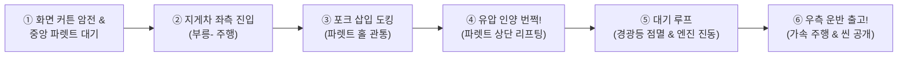

# [기획 지침서] 지게차 연출 전면 개편 & 바코드 스캔 타이밍/비주얼 개선

## 1. 개요 및 기획 의도
1. **지게차 연출 전면 개편**:
   - 기존의 난해했던 **정면 지게차(승강)**는 완전 삭제.
   - 직관적이고 실감 나는 **"중앙 파렛트 대기 ➔ 지게차 진입 ➔ 포크 꽂힘(도킹) ➔ 번쩍 들어올림 ➔ 우측 가속 운반 출고"** 단일 지게차 연출로 통합.
2. **바코드 스캔(BarcodeScan) 타이밍 및 레이저 면(Beam) 개선**:
   - **타이밍**: 화면이 닫히면서 동시에 찍지 않고, **좌우 바코드 커튼이 완전히 닫힌 후**에 비로소 스캔 레이저가 발동되도록 순차 시퀀스 수정.
   - **비주얼**: 얇은 8px 단순 선 대신, **두껍고 부드러운 반투명 레이저 면(두께 54px 광선 밴드 + 중심 네온 코어)**으로 실제 물류 스캐너 빔 시각화.
3. **13종 버튼 체계 정립**:
   - 혼란 없도록 **13종 (12종 트랜지션 + 1종 전체 랜덤)**으로 깔끔하게 재정렬.

---

## 2. 지게차 연출 상세 플로우 (Pickup & Carry)

### 2.1 지게차 연출 3단계 상세
- **PlayIn (화면 닫힘 & 화물 상차)**:
  - 배경 물류 슬레이트 커튼이 전개되어 100% 암전 커버.
  - 화면 중앙 바닥(`X: 0, Y: -160`)에 묵직한 **원목 파렛트 + 적재 택배 박스**가 대기.
  - 좌측 바깥(`X: -1550`)에서 노란색 지게차가 달려와 파렛트 앞(`X: -260`) 정차.
  - 전면 강철 포크가 파렛트 하단 홀로 **"착-!"** 꽂히며 도킹.
  - 유압 피스톤이 파렛트를 공중(`Y: -60`)으로 **"번쩍!"** 들어올림 (반동 바운스).
- **WaitingLoop (씬 로딩 대기)**:
  - 파렛트를 번쩍 든 상태에서 지게차 정차.
  - 상단 주황 경광등 삐뽀삐뽀 회전 점멸 & 디젤 엔진 미세 진동.
- **PlayOut (새 씬 오픈 & 화물 출고)**:
  - 파렛트를 든 채 우측 바깥(`X: +1600`)으로 **부르릉- 가속 출고!**
  - 배경 커튼이 함께 걷히며 새로운 씬 시원하게 공개.

---

## 3. 바코드 스캔(BarcodeScan) 개선 상세

1. **타이밍 분리 (닫힌 후 스캔)**:
   - 기존: 커튼이 닫히는 도중에 레이저가 동시에 지나가 화면이 가려지기도 전에 찍힘.
   - 개선: 좌우 바코드 커튼이 완전히 닫혀 화면을 100% 밀폐(`0.00s ~ 0.22s`)한 **직후(`0.24s`)**, 비로소 레이저 스캐너 빔이 활성화되어 위에서 아래로 솨아악- 스캔 (`0.24s ~ 0.46s`).
   - 스캔 완료 시 승인 그린 플래시 + `✔ BARCODE VERIFIED [OK]` 배지 팝업 (`0.48s`).
2. **레이저 빔 두께 및 반투명 면(Plane) 적용**:
   - 기존: 단순 8px 붉은 불투명 선.
   - 개선: 두께 **54px의 반투명 붉은 광선 면 (`RGBA 1.0, 0.2, 0.25, 0.55`)** + 중심 **고광도 네온 화이트/레드 코어 라인 (10px)** + 상하 소프트 그라데이션 글로우로 실제 핸드헬드/산업용 레이저 평면 빔 질감 구현.

---

## 4. 13종 트랜지션 및 버튼 재정렬 표

| 번호 | 버튼 레이블 | 트랜지션 타입 | 연출 테마 및 특징 |
| :---: | :--- | :--- | :--- |
| **01** | `01. ⚙️ 톱니바퀴` | `GearCircle` | 웜 앰버 12치 톱니바퀴 스냅 회전 |
| **02** | `02. 📦 택배박스` | `BoxFlap` | 4분할 3D 테이핑 박스 접힘 및 밀봉 |
| **03** | `03. 🚚 배송트럭` | `TruckWipe` | 3단 차등 속도 곡선 지평선 궤도 진입 |
| **04** | `04. 🪟 롤 셔터` | `ConveyorShutter` | 인더스트리얼 슬랫 셔터 하강 락킹 |
| **05** | `05. 🔖 송장봉투` | `StampInvoice` | 실감 서류봉투 UI & 대형 승인 도장 |
| **06** | `06. 🚜 지게차` | `ForkliftDrive` | **[전면 개편] 중앙 파렛트 대기 ➔ 포크 도킹 ➔ 번쩍 들어올려 운반 출고** |
| **07** | `07. 🏷️ 바코드` | `BarcodeScan` | **[개선] 커튼 닫힌 후 스캔 + 두꺼운 반투명 레이저 면(Beam)** |
| **08** | `08. 🧾 영수증` | `ReceiptRoll` | 영수증 지그재그 사선 롤 출력 및 찢기 |
| **09** | `09. 🚪 컨테이너` | `ContainerDoor` | 양문형 화물 컨테이너 개폐 & 잠금 레버 |
| **10** | `10. ⚠️ 주의테이프` | `FragileTape` | 테이프 완전 밀봉 후 중앙 스탬프 쾅! |
| **11** | `11. 🗺️ 월드맵` | `WorldMapPin` | 배송 노선 지도 줌 & GPS 마커 드롭 |
| **12** | `12. 🌠 별똥별메테오` | `DiagonalMeteor` | 슬림 별똥별 택배 코어 & 45° 대각 커튼 |
| **13** | `13. 🎲 전체 랜덤` | `RandomAll` | 12종 중 무작위 1종 발동 전환 |

---

## 5. 작업 승인 요청
- [ ] 지게차 승강 삭제 및 **중앙 파렛트 ➔ 포크 도킹 ➔ 번쩍 들어올려 운반 출고** 단일 지게차 개편안에 동의하십니까?
- [ ] 바코드 스캔을 **화면이 완전히 닫힌 후 스캔 + 두꺼운 반투명 레이저 빔 면**으로 개선하는 안에 동의하십니까?
- [ ] 13종 버튼 레이아웃으로 재정렬하는 안에 동의하십니까?
