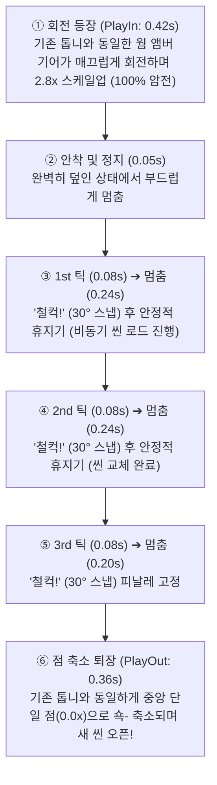

# [기획 지침서] 톱니(철컥) 3단계 리듬 템포 개선 & 지게차 포크 파렛트 관통 레이어링 (실제 결합감 구현)

## 1. 개요 및 피드백 분석
1. **톱니(철컥) 연출 템포 및 리듬감 전면 개편**:
   - `01. ⚙️ 톱니(회전)`과 동일하게 회전하며 웅장하게 등장.
   - 화면을 덮고 멈춘 뒤 **3번의 묵직한 기계식 비트 ("철컥 - [안정적 정지] - 철컥 - [안정적 정지] - 철컥")**.
   - 정지 구간 동안 백그라운드 씬 전환을 수행하여 멈칫거림/프레임 튐 완전 제거.
   - 회전 톱니와 동일하게 중앙 단일 점(`0.0x`)으로 축소 퇴장.
2. **지게차 포크 파렛트 결합 레이어링 (Fork Pocket Layering)**:
   - 포크가 파렛트 겉에 붕 떠서 덮이는 게 아니라, **파렛트 앞면 나무 프레임 안쪽으로 쏙 끼워져 가려지고, 오직 파렛트 구멍(Fork Hole) 사이로만 은빛 포크가 관통되어 보이도록** UI 계층(Z-Order / 레이어링) 구조 개선.

---

## 2. 세부 기획 및 기술 설계

### 2.1 [지게차] 파렛트 포크 관통 레이어링 구조 (3D 깊이감)
실제 물류 파렛트에 포크가 결합되는 단면 구조를 UI 3단 레이어로 분리합니다:

```
[UI 계층 순서: 뒤 ➔ 앞]
1. Pallet_BackWall : 파렛트 뒷면 그림자 및 내부 어두운 공간
2. ForkliftRoot (SteelForks) : 좌측에서 진입하는 은빛 강철 포크 날 (Y: -120)
3. Pallet_FrontFace : 파렛트 전면 목재 프레임 (상단 가로판, 하단 가로판, 좌/우/중앙 기둥 목재) & 적재 박스
```
- **시각적 효과**:
  - 포크가 진입할 때 전면 목재 기둥과 판자 뒤로 들어가 가려집니다.
  - 전면 목재 기둥 사이의 **[비어 있는 포크 관통 홀]**을 통해서만 은빛 강철 포크가 쑤욱- 지나가는 모습이 그대로 노출됩니다.
  - 결과적으로 **"파렛트 내부 구멍 속으로 완벽하게 끼워진(도킹된)"** 압도적인 현실감이 연출됩니다.

---

### 2.2 [톱니(철컥)] 연출 타임라인 및 시퀀스 설계



- **핵심 체감 개선**:
  - 틱과 틱 사이의 0.24초 안정적인 정지 타이밍에 씬 전환이 이루어지므로, 기존처럼 회전 중에 씬이 바뀌며 멈칫거리던 현상이 완전히 사라지고 묵직한 기계 템포로 체감됩니다.

---

## 3. 작업 파이프라인 계획
- **Lead Planner (기획자)**: 본 지침서 작성 및 파이프라인 관리.
- **Senior Unity Developer (서브에이전트)**:
  - `GearCircleTickTransition.cs`: 회전 진입 ➔ 3회 철컥/정지 시퀀스 ➔ 점 축소 퇴장 구현.
  - `ForkliftDriveTransition.cs` & `TransitionPrefabBuilder.cs`: 파렛트 전면 프레임과 홀 개구부 레이어를 포크 앞쪽에 배치하여 포크가 파렛트 내부로 관통 삽입되도록 레이어링 재구성.
- **Technical QA Inspector (서브에이전트)**:
  - 컴파일 에러 0건 검증.
  - 지게차 포크가 파렛트 홀 사이로 관통 결합되어 보이는지 비주얼 검증.
  - 톱니(철컥)의 멈춤 구간 동안 씬 전환이 끊김 없이 매끄럽게 이루어지는지 템포 검증.

---

## 4. 승인 요청
- [ ] 톱니(철컥)을 **회전 진입 ➔ 3회 철컥/정지 비트 ➔ 점 축소 퇴장**으로 개편하는 것에 동의하십니까?
- [ ] 지게차 포크를 **파렛트 전면 프레임 뒤로 넣고 구멍 사이로만 관통되어 보이도록 레이어링**하는 것에 동의하십니까?
- [ ] 승인해 주시면 즉시 개발자 ➔ QA 인스펙터 파이프라인을 가동하겠습니다.

