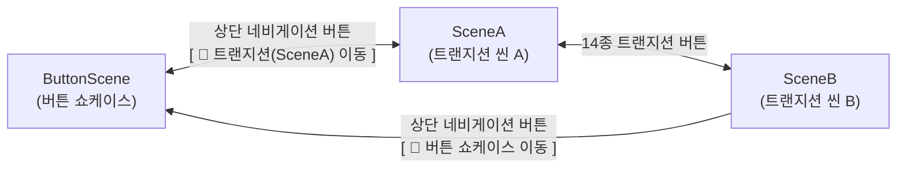

# [기획 지침서] 크로스 씬 네비게이션: ButtonScene ↔ SceneA/SceneB 상호 이동 버튼 및 Build Settings 통합

## 1. 개요 및 기획 의도
- **배경**: 현재 프로젝트는 `ButtonScene`(버튼 쇼케이스)과 `SceneA`/`SceneB`(트랜지션 쇼케이스)로 분리되어 있으며, 상호 이동 수단이 없어 실제 빌드 배포 후에는 트랜지션 씬에서 버튼 씬으로, 혹은 버튼 씬에서 트랜지션 씬으로 이동할 수 없는 문제가 있습니다.
- **목표**: 
  1. `SceneA`와 `SceneB` 상단에 **`[ 🔘 버튼 쇼케이스로 이동 ]`** 네비게이션 버튼 배치.
  2. `ButtonScene` 상단에 **`[ 🚚 트랜지션 씬(SceneA)으로 이동 ]`** 네비게이션 버튼 배치.
  3. Unity Build Settings에 `ButtonScene`, `SceneA`, `SceneB` 3개 씬을 모두 활성화 등록하여 빌드 후에도 모든 쇼케이스를 자유롭게 오갈 수 있도록 보장.

---

## 2. 씬 상호 네비게이션 구조 및 UI 배치 설계

### 2.1 [SceneA & SceneB] ➔ ButtonScene 이동 버튼
- **위치**: 캔버스 우측 상단 (`anchoredPosition = (-150, -45)`, `pivot = (1, 1)`) 또는 헤더 우측 여백.
- **스타일**: 
  - 버튼 레이블: `🔘 버튼 쇼케이스 이동 ➔`
  - 컬러: 인더스트리얼 슬레이트 블루 (`#2B3E50`) + 골드 보더 테두리
  - 크기: `240 x 48`
- **인터랙션**:
  - 클릭 시 `SceneManager.LoadScene("ButtonScene")` (또는 TransitionManager가 활성화되어 있으면 트랜지션과 함께 우아하게 이동).

### 2.2 [ButtonScene] ➔ SceneA 이동 버튼
- **위치**: `ButtonScene`의 Header 패널 우측 (`anchoredPosition = (800, 0)` 또는 우측 상단 `( -160, -45 )`).
- **스타일**:
  - 버튼 레이블: `🚚 트랜지션 씬(SceneA) 이동 ➔`
  - 컬러: 따뜻한 앰버 골드 (`#F5943A`) + 화이트 볼드 텍스트
  - 크기: `260 x 48`
- **인터랙션**:
  - 클릭 시 `SceneManager.LoadScene("SceneA")` 실행.

### 2.3 Build Settings 등록 (3개 씬 통합)
- Index 0: `Assets/Scenes/ButtonScene.unity` (메인 시작 씬)
- Index 1: `Assets/Scenes/SceneA.unity` (트랜지션 센터 A)
- Index 2: `Assets/Scenes/SceneB.unity` (트랜지션 허브 B)
- 3개 씬 모두 `enabled = true`로 등록하여 단독 실행 및 패키지 빌드 시 누락 방지.

---

## 3. 작업 파이프라인 계획
- **Lead Planner (기획자)**: 본 지침서 작성 및 파이프라인 관리.
- **Senior Unity Developer (서브에이전트)**:
  - `TransitionDemoController.cs` & `SceneBController.cs`: `ButtonScene` 이동 버튼 바인딩 추가.
  - `ButtonSceneBuilder.cs`: 상단 헤더에 `SceneA` 이동 버튼 및 클릭 리스너 스크립트 연동.
  - `TransitionPrefabBuilder.cs`: 3개 씬 Build Settings 등록 및 상단 네비게이션 버튼 자동 생성 반영.
- **Technical QA Inspector (서브에이전트)**:
  - 컴파일 에러 0건 검증.
  - Build Settings 3개 씬 등록 검증.
  - `ButtonScene` ➔ `SceneA` ➔ `SceneB` ➔ `ButtonScene` 전 구간 순환 이동 테스트 및 에러 0건 검증.

---

## 4. 승인 요청
- [ ] `ButtonScene` ↔ `SceneA`/`SceneB` 간 상호 이동 네비게이션 버튼을 추가하는 데 동의하십니까?
- [ ] Build Settings에 3개 씬을 모두 등록하여 빌드 시에도 정상 동작하도록 하는 데 동의하십니까?
- [ ] 승인해 주시면 즉시 개발자 ➔ QA 인스펙터 파이프라인을 가동하겠습니다.
