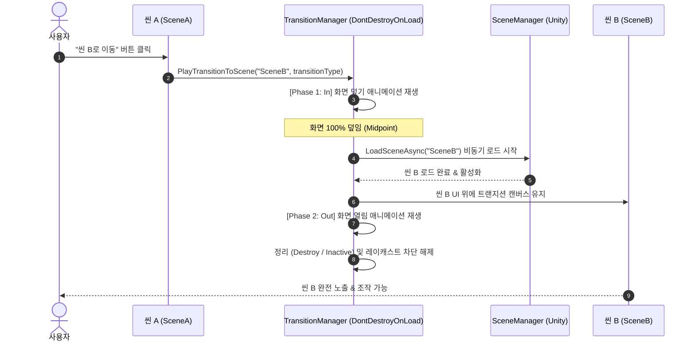

# [작업지시서] 씬 A ↔ 씬 B 크로스 트랜지션 연동 및 물류 애니메이션 개편

## 1. 개요 및 목적 (Overview)
- **작업 목적**:
  1. **실제 씬 전환 파이프라인 구축 (Scene A ↔ Scene B)**:
     - 버튼 클릭 시 `In` 애니메이션으로 화면을 덮음.
     - **중간 지점(Midpoint)**에서 `SceneManager.LoadSceneAsync`를 통해 백그라운드로 씬을 교체.
     - 씬 B가 로드된 후 덮인 화면이 열리는 **`Out` 애니메이션이 씬 B 화면 위에서 재생**되도록 연결.
     - 씬 B에는 "씬 A로 돌아가기" 버튼이 존재해야 하며, 동일한 메커니즘으로 복귀.
  2. **톱니바퀴 트랜지션(GearCircle) 연출 최적화**:
     - 과도한 회전(수 바퀴)을 **딱 반 바퀴(180°)**로 절제하여 묵직하고 정확한 메카닉 느낌 부여.
     - 크기를 훨씬 큼직하게 확대하고, 퀄리티 높은 **톱니바퀴 이모지(`⚙️`) / 고대비 그래픽** 적용.
  3. **배송 트럭 와이프(TruckWipe) 시네마틱 주행 연출 개편**:
     - 트럭이 슬라이드를 끌고 오는 것이 아니라, **슬라이드가 먼저 덮인 후 트럭이 따라 들어옴**.
     - 씬 로딩 대기 시간 동안 트럭이 멈추지 않고 **위아래로 들썩들썩(엔진/주행 진동)** 연출.
     - 바퀴 아래/주변에 **둥그스름한 호(Arc, 반원/1/3원) 주행풍 회전 이펙트**를 추가하여 고속 주행감 극대화.
     - 로딩 완료 후 슬라이드와 함께 시원하게 퇴장.
  4. **씬 B ➡️ 씬 A 복귀용 신규 물류 트랜지션 5종 기획 및 추가**:
     - 복귀 시 임의로 선택 재생할 수 있는 물류 테마 전용 5종 애니메이션 구현.

---

## 2. 크로스 씬 전환 시스템 설계 (Cross-Scene Architecture)

### 2.1 씬 전환 흐름도 (Sequence Diagram)


### 2.2 구현 필수 규격
- **`TransitionManager` (DontDestroyOnLoad 싱글톤)**:
  - 씬이 전환되어도 트랜지션 UI 캔버스가 파괴되지 않아야 씬 B에서 `Out` 애니메이션을 끊김 없이 재생할 수 있음.
  - 전환 중에는 `CanvasGroup.blocksRaycasts = true`로 사용자의 화면 터치/클릭을 원천 차단.
  - `SceneManager.sceneLoaded` 이벤트를 수신하여 씬 B 준비가 확인된 후 `PlayOutAnimation()`을 트리거.

---

## 3. 세부 연출 작업지시서 (Visual Polish)

### Task 1. 톱니바퀴 트랜지션 (`GearCircleTransition.cs`) 개편
- **회전 각도**: 기존의 고속 다회전을 제거하고, 화면이 덮이는 동안 **딱 180°(반 바퀴)만 묵직하게 회전** (`SetEase(Ease.OutCubic)`).
- **스케일 및 크기**:
  - 화면 중앙을 압도할 수 있도록 기어 크기를 기존 대비 1.5배~2배 확대.
- **비주얼**:
  - 기존 단순 프로시저럴 원형 대신, 또렷하고 입체감 있는 톱니바퀴 텍스트 이모지(`⚙️` TextMeshPro/Text) 또는 정밀 기어 스프라이트 적용.
  - 기어가 맞물려 돌아가며 찰칵 멈추는 기계적 스냅감 부여.

### Task 2. 배송 트럭 와이프 (`TruckWipeTransition.cs`) 리뉴얼
- **연출 단계 (5 Steps)**:
  1. **슬라이드 선행 전개 (0.45s)**: 주황/옐로우 배송 슬라이드 배경이 먼저 좌 ➡️ 우로 화면 전체를 덮음.
  2. **트럭 후속 진입 (0.4s)**: 슬라이드가 덮이는 중반부터 붉은 배송 트럭이 좌측에서 미끄러져 들어와 화면 중앙(살짝 좌측)에 정위치.
  3. **정지 주행 & 들썩들썩 연출 (대기 시간)**:
     - 씬이 비동기 로딩되는 동안 트럭이 가만히 있지 않고, 택배 화물과 트럭 바디가 위아래로 덜덜거리는 점핑 진동(`DOShakePosition` 또는 `DOPunchPosition(y축, 0.2s)` 반복 루프).
  4. **바퀴 회전풍 호(Arc) 이펙트**:
     - 트럭 앞바퀴/뒷바퀴 밑과 뒤쪽에 둥그스름한 반원/부채꼴 모양의 호 선(Curved Arc Lines) 2~3개를 배치.
     - 이 호들이 바퀴 회전 방향으로 빠르게 회전(`DORotate`) 및 페이드아웃을 반복하여 '질주하고 있는 역동적인 바퀴 회전' 표현.
  5. **동반 퇴장 (0.4s)**: 씬 로딩 완료 신호가 오면, 슬라이드가 열리며 트럭이 부스터를 쓴 것처럼 우측 화면 밖으로 가속 퇴장 (`Ease.InBack` or `InCubic`).

---

## 4. 씬 B ➡️ 씬 A 복귀용 신규 물류 트랜지션 5종 기획

씬 B의 복귀 버튼 클릭 시 임의(Random) 또는 선택으로 재생될 신규 트랜지션 5종 명세:

| 번호 | 트랜지션 명칭 | In 연출 (화면 덮기) | Midpoint (로딩 중) | Out 연출 (화면 열기) |
|---|---|---|---|---|
| **1** | **지게차 리프트<br>(Forklift Lift)** | 노란 지게차 포크가 거대한 나무 팔레트를 아래에서 위로 번쩍 들어올려 화면을 덮음 | 지게차 경광등이 삐뽀삐뽀 회전 | 팔레트를 쿵 내려놓고 지게차가 후진으로 퇴장하며 씬 A 노출 |
| **2** | **바코드 스캐너 빔<br>(Barcode Scan)** | 붉은 레이저 라인이 위에서 아래로 스캔하며 흑백 바코드 블라인드가 쫙 닫힘 | '삐빅!' 스캔 비프음 연출 & 그린 승인 바코드 라이트 | 바코드가 중앙에서 좌우로 갈라지며 씬 A 오픈 |
| **3** | **에어캡 뽁뽁이<br>(Bubble Wrap)** | 투명-하늘색 에어캡 뽁뽁이 시트가 화면을 덮음 | 뽁! 뽁! 뽁! 3~4개의 뽁뽁이가 팡팡 터짐 | 에어캡 시트가 가운데 절취선을 따라 좌우로 찢어지며 씬 A 노출 |
| **4** | **물류 컨테이너 문<br>(Container Door)** | 거대한 해상용 스틸 컨테이너 양문이 좌우에서 중앙으로 쾅! 닫히며 래치로 잠김 | 잠금 봉(Lock Rod)이 찰칵 체결됨 | 래치가 풀리며 양문이 밖으로 활짝 젖혀지며 씬 A 오픈 |
| **5** | **배송 드론 착륙<br>(Delivery Drone)** | 프로펠러를 돌리는 배송 드론이 택배 상자를 매달고 화면 위에서 급강하해 화면을 채움 | 드론의 집게가 탁 풀리며 배송 완료 표시 | 드론이 상공으로 솟구쳐 날아가고 상자가 열리며 씬 A 오픈 |

---

## 5. 검수 및 컴파일 체크리스트 (Verification Checklist)

### 1) 컴파일 및 빌드 세팅 검수
- [ ] Unity 에디터 콘솔에 컴파일 에러가 전혀 없는가? (0 Errors)
- [ ] **File > Build Settings**의 `Scenes In Build` 목록에 `SceneA`와 `SceneB`가 모두 등록되어 있는가? (누락 시 `LoadScene` 런타임 오류 발생)

### 2) 크로스 씬 런타임 안정성 검수
- [ ] 씬 A에서 버튼을 눌렀을 때 화면이 완전히 덮이기 전에 씬 B가 깜빡이며 먼저 노출되지 않는가?
- [ ] 씬 B로 넘어간 후, 트랜지션 캔버스가 씬 B 위에서 정상적으로 `Out` 애니메이션을 재생하는가?
- [ ] `Out` 애니메이션이 끝난 후 화면 터치 및 버튼 클릭(`blocksRaycasts`)이 정상적으로 풀리는가?
- [ ] 씬 B의 "씬 A로 돌아가기" 버튼이 정상 작동하여 역방향으로 씬 A 복귀가 되는가?
- [ ] 씬을 여러 번 왔다 갔다(A ➡️ B ➡️ A ➡️ B) 반복해도 `DontDestroyOnLoad` 매니저 객체가 중복 복제되지 않는가?

### 3) 비주얼 및 연출 QA
- [ ] **톱니바퀴**:
  - [ ] 팽이처럼 빙글빙글 돌지 않고, 묵직하게 반 바퀴(180°)만 딱 돌아가는가?
  - [ ] 톱니바퀴 크기와 이모지(`⚙️`) 그래픽이 선명하고 크게 보이는가?
- [ ] **배송 트럭**:
  - [ ] 슬라이드가 먼저 덮인 후 트럭이 들어오는 순서가 지켜지는가?
  - [ ] 로딩 대기 동안 트럭 본체가 위아래로 들썩거리며 살아있는 주행 느낌을 주는가?
  - [ ] 바퀴 밑에 둥그스름한 호(Arc) 회전선이 표시되어 달리는 바퀴의 회전감이 느껴지는가?
- [ ] **복귀 애니메이션**:
  - [ ] 씬 B에서 씬 A로 올 때 신규 트랜지션 연출이 정상적으로 발동하는가?

---

## 6. AI 개발 에이전트 실행 프롬프트 (Prompt for Agent)

```text
다음 명세에 따라 SceneA와 SceneB 간의 크로스 씬 트랜지션 시스템을 구축하고 애니메이션을 개편하세요.

1. Cross-Scene 전환 시스템 구현:
   - DontDestroyOnLoad 기반의 TransitionManager 싱글톤을 구축하세요.
   - SceneA의 버튼 클릭 시 [In 애니메이션] -> [Midpoint에서 SceneManager.LoadSceneAsync("SceneB")] -> [SceneB 로드 완료 후 Out 애니메이션] 순서로 제어하세요.
   - SceneB에 "씬 A로 돌아가기" 버튼을 생성하고, 동일한 방식으로 SceneA로 복귀하도록 바인딩하세요.
   - Build Settings에 SceneA, SceneB가 누락되지 않도록 확인/추가하세요.

2. GearCircleTransition 개편:
   - 회전 각도를 180도(반 바퀴)로 제한하고 OutCubic으로 절제된 회전을 적용하세요.
   - 기어 크기를 대폭 확대하고 톱니바퀴 이모지(⚙️) 또는 고화질 그래픽으로 교체하세요.

3. TruckWipeTransition 시네마틱 개편:
   - 배경 슬라이드가 먼저 화면을 덮은 뒤 트럭이 따라 들어오도록 타이밍을 분리하세요.
   - 씬 로딩 대기 시간 동안 트럭 바디가 위아래로 들썩거리도록 DOPunchPosition/Shake 루프를 구현하세요.
   - 트럭 바퀴 밑/뒤에 둥근 호(Arc Line) 형태의 주행풍 회전 이펙트를 배치하여 회전 애니메이션을 적용하세요.
   - 씬 로드 완료 후 슬라이드와 함께 우측으로 시원하게 가속 퇴장시키세요.

4. SceneB -> SceneA 복귀용 신규 물류 트랜지션 추가:
   - 지게차 리프트, 바코드 스캐너, 에어캡 뽁뽁이, 컨테이너 문, 배송 드론 중 선택/랜덤 재생되도록 신규 트랜지션을 추가 구현하세요.

작업 완료 후 반드시 씬 전환 루프(A->B->A) 및 컴파일 에러를 검수하세요.
```
